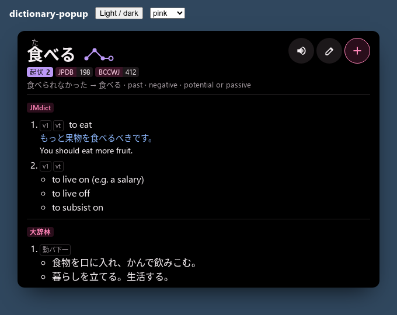

# dictionary-popup

The dictionary popup from [LFG](https://github.com/bee-san/LearnFromGames), for any web page: a looked-up word with its reading over it, its pitch drawn beside it, how common it is, the inflections undone to find it, each dictionary's definitions in that dictionary's own styles, and a round **+** that adds its card and turns into a green tick.



It shows what [Hoshidicts](https://github.com/bee-san/hoshidicts) finds (through its C interface, its wasm build or LFG's JNI), and anything else you put in the same shape. It doesn't look words up or talk to Anki itself: you give it results, and it tells you when a button is pressed.

## Install

```sh
npm install github:bee-san/dictionary-popup
```

There's nothing to build and nothing it depends on.

## Use

```js
import { createDictionaryPopup } from "dictionary-popup";

const popup = createDictionaryPopup(document.getElementById("popup"), {
  theme: "dark",
  scheme: "pink",
  onAddCard(result, index) {
    popup.setCardState(index, "adding");
    addToAnki(result).then(() => popup.setCardState(index, "in-anki"));
  },
});

popup.render(results, { styles, added: ["景色"] });
```

The popup is one element (`popup.element`, class `dictionary-popup`) with a shadow root, so its styles and your page's never meet. It's as tall as its entries; give it a `max-height` and it scrolls inside. It runs no script of its own in the page, so a Content Security Policy only has to allow inline styles, which dictionaries use.

## Results

`render(results, options)` takes an array of these (`src/index.d.ts` has the types):

```js
{
  matched: "食べられなかった",          // the text it was found as
  deinflected: "食べる",
  trace: [{ name: "past" }, { name: "negative" }],
  term: {
    expression: "食べる",
    reading: "たべる",
    rules: "v1 vt",
    glossaries: [{ dictionary: "JMdict", glossary: "[\"to eat\"]", definitionTags: "1 v1 vt" }],
    frequencies: [{ dictionary: "JPDB", frequencies: [{ value: 198, displayValue: "198" }] }],
    pitches: [{ dictionary: "NHK", pitches: [{ position: 2 }] }],
  },
}
```

A glossary is what a Yomitan dictionary holds: structured content as JSON, or a JSON array of strings. Of a dictionary's content only Yomitan's own tags, data attributes and style properties are kept, so none of it becomes script.

## API

`createDictionaryPopup(container, options)` returns the popup.

| Option | |
|---|---|
| `theme` | `"dark"` (default) or `"light"`. |
| `scheme` | LFG's colour scheme: `"pink"` (default), `"mono"`, `"amber"`, `"teal"` or `"purple"`. |
| `colors` | Any of `bg`, `surface`, `border`, `borderStrong`, `text`, `dim`, `accent`, `soft`, `ok`, `okSoft`, `chip`, `freqName`, `freqNameText`, over the scheme's. |
| `fontSize` | In px (default 16). |
| `css` | Extra CSS for the popup. |
| `onAddCard(result, index)` | The card button of a word not added yet. Without it there's no card button. |
| `onOpenCard(result, index)` | The card button of a word that's in Anki. |
| `onPlayAudio(result, index)` | The audio button. Without it there's no audio button. |
| `hasAudio(result)` | Whether a word has audio to play (default: every word). |
| `onNote(result, index)` | The note button. Without it there's no note button. |
| `mediaUrl(dictionary, path)` | A URL for a dictionary's picture. Without it pictures are left out. |

| The popup | |
|---|---|
| `render(results, { styles, states, added })` | Shows results. `styles` is each dictionary's CSS (`[{ dictionary, styles }]`), limited to its entries; `states` each result's card state; `added` the expressions already in Anki. |
| `setCardState(index, state)` | `"add"` (**+**), `"adding"`, `"in-anki"` (a green tick) or `"waiting"` (AnkiDroid isn't answering yet). |
| `setAdded(expressions)` | Turns the **+** of those words into a green tick. |
| `setCurrent(index, { scroll })` | Marks the entry a controller or keyboard is on. |
| `setTheme({ theme, scheme, colors, fontSize, css })` | Changes how it looks. |
| `clear()` | Empties it. |
| `destroy()` | Takes it out of the page. |
| `element` | The popup's element. |

The parts are exported too, for hosts that want the HTML without the element: `toEntry`, `body`, `listBody`, `glossary`, `furigana`, `graph`, `scope`, `accents`, `shortName`, `frequencyRank`, `paletteOf`, `colours`, `hostCss`.

## Try it

```sh
python3 -m http.server 8799
# http://127.0.0.1:8799/example/
# ?theme=light&scheme=teal for another look, &added for a word that's in Anki
```

## Where it comes from

It's a port of LFG's Kotlin (`app/src/main/kotlin/io/github/beesan/lfg/` in [bee-san/LearnFromGames](https://github.com/bee-san/LearnFromGames)), where the popup is developed: `dict/EntryHtml.kt` is `src/entry-html.js`, `dict/Pronunciation.kt` is `src/pronunciation.js` and `core/Palette.kt` is `src/palette.js`. LFG's stylesheet is taken as it is:

```sh
node scripts/sync-from-lfg.mjs ../LearnFromGames   # writes src/base-css.js from EntryHtml.kt's BASE_CSS
npm test
```

Changes to LFG's Kotlin are brought across by hand. It was last matched against LearnFromGames `3170fc7`.

## License

GPL-3.0-or-later, as LFG is.
