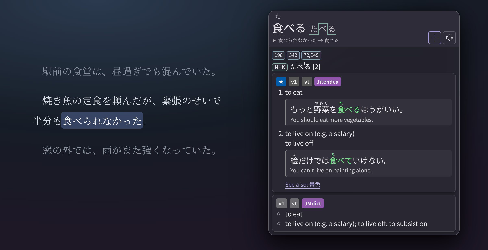

# dictionary-popup

[Hachidori](https://github.com/bee-san/hachidori)'s Japanese dictionary popup, for any web page.



- The word with furigana, its pitch accent and how common it is
- How it was deinflected (食べられなかった → 食べる)
- Each dictionary's definitions in that dictionary's own styles: structured content, tables, pictures, tag colours
- Buttons to add an Anki card and play audio
- Tap a word in a definition to look it up, with Back to return

This is Hachidori's real renderer and stylesheet, not a copy of them. The package doesn't look words up or talk to Anki: you give it results (from [Hoshidicts](https://github.com/bee-san/hoshidicts) or anything else in the same shape) and it calls you back when a button is pressed.

## Install

```sh
npm install github:bee-san/dictionary-popup
```

No build step and no dependencies.

npm 12 and later refuse packages from git by default (`EALLOWGIT`). Add `allow-git=root` to your project's `.npmrc`, or copy `src/` into your project.

## Use

```js
import { createDictionaryPopup } from "dictionary-popup";

const popup = createDictionaryPopup(document.getElementById("popup"), {
  onAddCard(result, index) {
    popup.setCardState(index, "adding");
    addToAnki(result).then(() => popup.setCardState(index, "in-anki"));
  },
  onPlayAudio: (result) => play(result.term.expression, result.term.reading),
  lookup: (text) => lookUp(text), // for a word tapped in a definition
});

popup.render(results, { styles, added: ["景色"] });
```

The popup lives in a shadow root inside your element, so its CSS and yours don't touch. It's as wide as the element and as tall as its content. Give the element a `max-height` and the definitions scroll under a pinned headword.

Importing the package sets `HDPopup`, `HDGlossary` and `HDExternalLinks` on `globalThis`, because Hachidori's scripts find each other there.

## Results

`render()` takes an array of results like this (full types in `src/index.d.ts`):

```js
{
  matched: "食べられなかった",
  deinflected: "食べる",
  trace: [{ name: "past", description: "did" }, { name: "negative" }],   // or `process`
  term: {
    expression: "食べる",
    reading: "たべる",
    rules: "v1 vt",
    glossaries: [{ dictionary: "JMdict", glossary: "[\"to eat\"]", definitionTags: "v1 vt" }],
    frequencies: [{ dictionary: "JPDB", frequencies: [{ value: 198, displayValue: "198" }] }],
    pitches: [{ dictionary: "NHK", pitches: [{ position: 2 }] }],
  },
}
```

A `glossary` is what a Yomitan dictionary stores: structured content as JSON, or a JSON array of strings. Add `tags` (`[{ name, category, notes }]`, from the dictionary's tag bank) to give definition tags their colours and tooltips. Without them the names in `definitionTags` show plain.

Dictionary content can't run script: every element is built from the tags, attributes and styles Yomitan allows.

## API

### `createDictionaryPopup(container, options)`

| Option | |
|---|---|
| `theme` | A palette from `THEMES`: `"default"` (dark), `"auto"`, `"light"`, `"dark"`, `"catppuccin-mocha"`, `"high-contrast"` and more. |
| `opacity` | Background opacity, 0–100. Default 85. |
| `display` | Hachidori's display settings, over `DEFAULT_DISPLAY`: `showFrequencyDictionaryNames`, `averageFrequency`, `compactFrequencyNumbers`, `showPitchAccentFurigana`, `showPitchAccentGraph`, `showPitchAccentColors`, `hidePopupGrammarTags`, `glossaryLayoutMode`, `popupColumns` and others. |
| `dictionaries` | `[{ title, displayName, frequencyMode, favorite }]`: a display name, whether frequencies are ranks or counts, and whether the dictionary gets its own tab. |
| `tabGroups` | Dictionaries that share a tab: `[{ id, name, dictionaries: [title] }]`. |
| `css` | Extra CSS for the popup. |
| `initialResultCount` | Results drawn straight away; the rest are drawn when the page is idle. Default 1. |
| `onAddCard(result, index)` | Anki button for a word not yet added. No Anki button without it. |
| `onOpenCard(result, index)` | Anki button for a word already in Anki. |
| `onPlayAudio(result, index)` | Audio button. No audio button without it. |
| `hasAudio(result)` | Whether a word has audio. Default: always. |
| `lookup(text)` | Looks up words at the start of `text`, for words tapped in definitions, links to other entries and kanji in the headword. Returns results or `{ results, styles, states, added }`, or a promise of either. No lookups without it. |
| `media(dictionary, path)` | Returns a URL or Blob (or a promise of one) for a dictionary image. Images are left out without it. |
| `onExternalLink(url)` | A link out of a definition. Default: opens in a new tab. |
| `onClose()` | Adds a close button. |

### The popup

| | |
|---|---|
| `render(results, { styles, states, added })` | Shows results. `styles` is each dictionary's CSS (`[{ dictionary, styles }]`), scoped to its own entries. `states` is each result's card state; `added` lists expressions already in Anki. No results hides the popup. |
| `notice(message)` | Shows a message instead of entries, like "No definition found." |
| `setCardState(index, state, message)` | `"add"`, `"adding"`, `"in-anki"`, `"duplicate"` (in Anki, can be added again), `"waiting"` (Anki hasn't answered), `"error"` or `"unavailable"`. `message` is the button's tooltip. |
| `setAdded(expressions)` | Marks words as in Anki. |
| `setCurrent(index)` | Jumps to an entry. |
| `back()` | Goes back from a word looked up in a definition. |
| `setTheme({ theme, opacity, display, dictionaries, tabGroups, css })` | Changes the look. |
| `clear()` | Empties and hides the popup. |
| `destroy()` | Removes it from the page. |
| `element` | The popup's element (class `dictionary-popup`). |

Hachidori's own modules are exported too: `HDPopup` (`render/popup.js`), `HDGlossary` (`render/glossary.js`), `READER_CSS`, `ICONS_CSS`, and `toHachidori`, which converts a result to Hachidori's format.

## Differences from the extension

The popup sits in your element instead of floating next to a word, and a word looked up from a definition replaces the view (with Back) instead of opening a second popup.

Not included, because they need the rest of the extension: settings pages, profiles, languages other than Japanese, the note editor, custom buttons and links, user scripts, the audio source list, lookup counts, definition blur, the kanji view (kanji are looked up as words), image enlarge on hover, drag-to-resize, highlighting the word on the page, and Hachidori's other popup themes (JL, Nazeka, Plain, Bee's Theme, Crystal).

## Older browsers

Hachidori targets current Chrome. Its CSS uses `color-mix()`, `oklch()`, `light-dark()` and unprefixed `mask`, and dictionaries like Jitendex use nested CSS. An Android WebView that's never been updated (Android 13 ships WebView 109) supports none of these.

On browsers that need it, `src/legacy.js` fills the gaps: it computes those colours as plain `rgba()`, adds `-webkit-mask`, flattens nested rules, and finds the tapped character without `caretPositionFromPoint`. In Chromium 109 the popup then looks the same as in a current Chrome. Two things it can't fix: colours mixed with `currentColor`, and the tint behind pitch dictionary names when `showPitchAccentColors` is on.

## Try it

```sh
python3 -m http.server 8799
# open http://127.0.0.1:8799/example/
# add ?theme=light, &added (word already in Anki) or &noaudio
```

`npm test` runs the popup in jsdom. jsdom has no constructed stylesheets, so dictionary styles only show in a real browser. To check an old WebView, open the example in Chromium 109 (`npx playwright@1.29 install chromium`).

The picture above is `docs/screenshot.html`, taken at 1200×616 and 2× scale.

## Updating from Hachidori

`src/hachidori` is generated by a script; don't edit it by hand. `src/hachidori/source.json` records the Hachidori commit it came from (currently `5a5b5e2`).

| Here | In Hachidori |
|---|---|
| `src/hachidori/popup.js` | `extension/render/popup.js` |
| `src/hachidori/glossary.js` | `extension/render/glossary.js` |
| `src/hachidori/external-links.js` | `extension/external-links.js` |
| `src/hachidori/reader-css.js` | `extension/render/reader.css` |
| `src/hachidori/icons-css.js` | `extension/icons.css` |

```sh
node scripts/sync-from-hachidori.mjs ../hachidori   # reads origin/main from git, or pass another ref
npm test
```

The rest is this package's own: `src/index.js` does what the extension's content scripts do (shadow root, Anki button, lookups from definitions), `src/embed-css.js` lets the popup sit inside a page element, and `src/legacy.js` handles older browsers. After syncing, check the popup in an old Chromium, since new CSS in Hachidori breaks there first. If Hachidori changes what `createPopupView` takes or returns, update `src/index.js` to match.

## License

GPL-3.0-or-later, like Hachidori. `src/hachidori/ATTRIBUTION.md` credits the projects the popup builds on (GameSentenceMiner, Hoshi Reader, Yomitan, Hoshidicts). The icons are Microsoft's Fluent System Icons (MIT, `src/hachidori/LICENSE.fluent-icons`).
